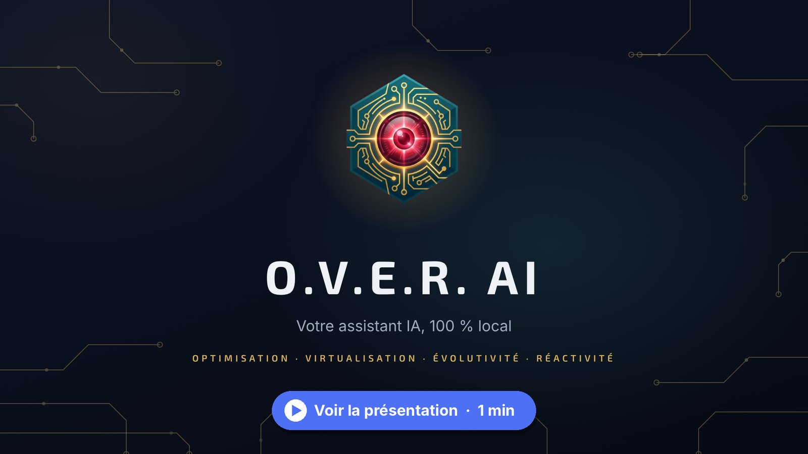
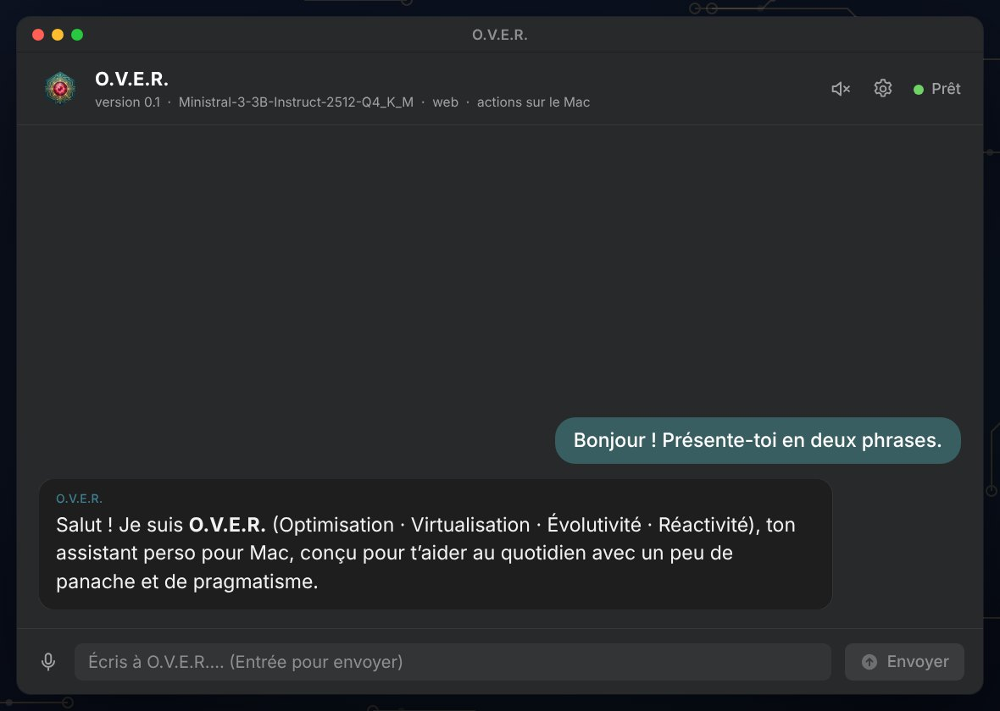
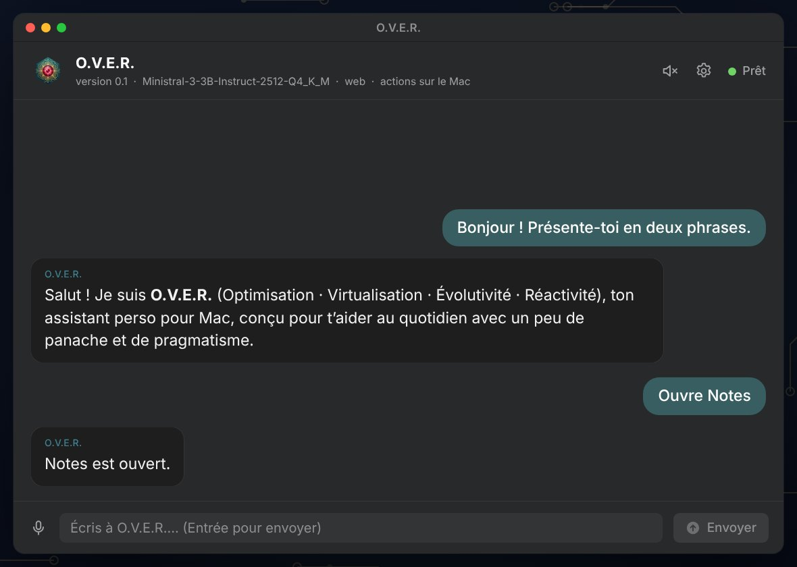
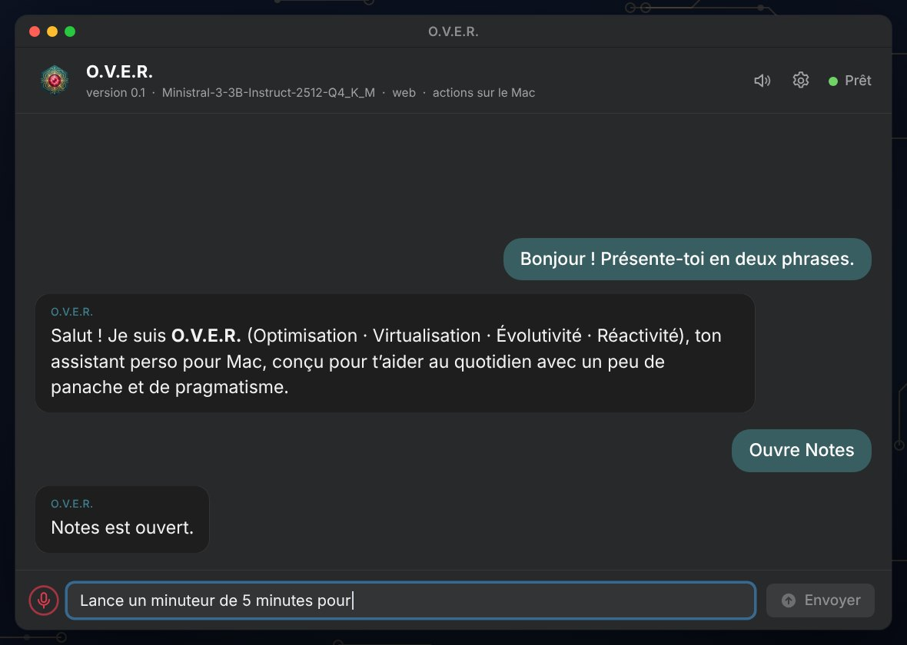
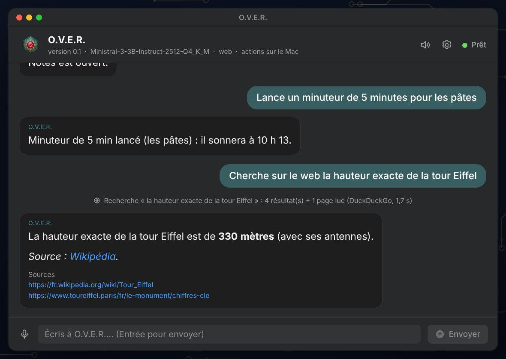
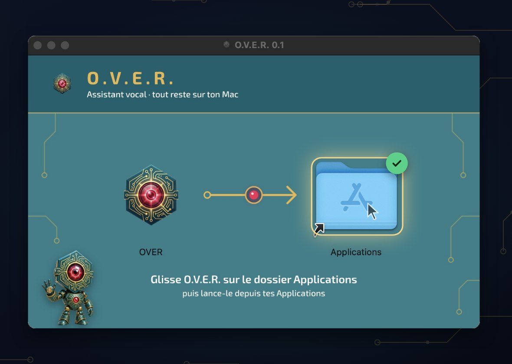
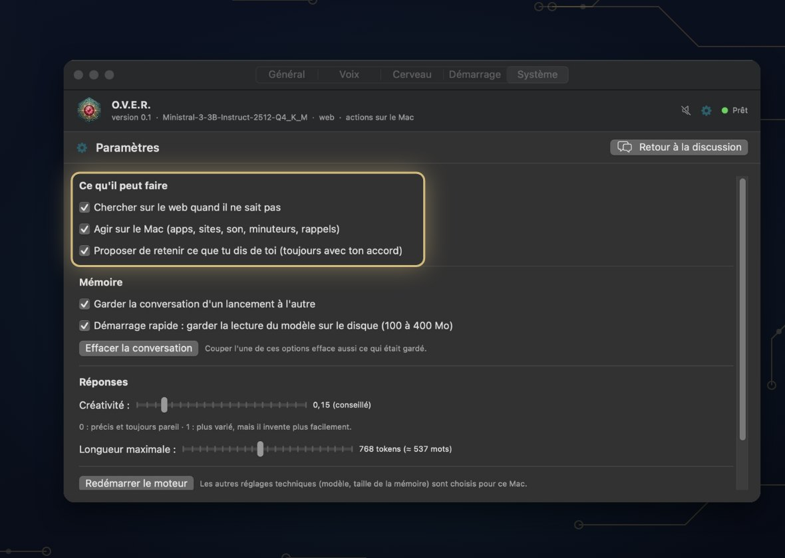

<div align="center">


# O.V.E.R. AI

**Votre assistant IA, 100 % local**

*Optimisation · Virtualisation · Évolutivité · Réactivité*

[](https://github.com/OVER-AI-DOMOTIQUE/O.V.E.R.-Macos/releases/latest)
[](#configuration-requise)
[](LICENSE.md)
[](#confidentialité)

**[Télécharger](https://github.com/OVER-AI-DOMOTIQUE/O.V.E.R.-Macos/releases/latest)** · **[Site officiel](https://iaover.fr)** · **[Vidéo de présentation](https://github.com/user-attachments/assets/64a4ea94-5241-4ce7-9c50-c18038e4b0cd)**

<a href="https://github.com/user-attachments/assets/64a4ea94-5241-4ce7-9c50-c18038e4b0cd">
  
</a>

</div>

---

## Présentation

O.V.E.R. est un assistant personnel en français qui fonctionne **entièrement sur votre Mac**. Vous lui écrivez ou vous lui parlez, il vous répond par écrit et, si vous le souhaitez, à voix haute. Il peut aussi agir sur votre Mac, chercher sur le web quand il ne sait pas et se souvenir de ce que vous lui confiez, avec votre accord.

Le modèle de langage, vos conversations et sa mémoire restent sur votre ordinateur : aucun service d'intelligence artificielle en ligne, aucun compte, aucun abonnement.

- **Modèle** : [Ministral 3 3B Instruct](https://huggingface.co/mistralai/Ministral-3-3B-Instruct-2512-GGUF) de Mistral AI (licence Apache 2.0), quantifié en Q4_K_M (≈ 2,1 Go)
- **Moteur** : [llama.cpp](https://github.com/ggml-org/llama.cpp) via llama-cpp-python, compilé pour les processeurs Intel récents (AVX2, FMA, F16C)
- **Écoute** : [whisper.cpp](https://github.com/ggml-org/whisper.cpp), sur le Mac · **Voix** : celles de macOS

## Fonctionnalités

<table>
  <tr>
    <td width="50%" valign="top">
      
      <h3>Discuter</h3>
      Une vraie fenêtre de discussion en bulles, en français. Les réponses s'écrivent au fil de l'eau et le bouton <b>Arrêter</b> (⌘.) les interrompt à tout moment.
    </td>
    <td width="50%" valign="top">
      
      <h3>Agir sur le Mac</h3>
      Ouvrir une app ou un site, régler le son, donner l'heure, lancer un minuteur, créer un rappel : une phrase suffit. La création d'un rappel demande toujours votre confirmation.
    </td>
  </tr>
  <tr>
    <td width="50%" valign="top">
      
      <h3>Parler</h3>
      Micro (⌘D) ou raccourci à maintenir (⌃⌥ Espace). La reconnaissance vocale tourne sur le Mac avec whisper.cpp, et les réponses peuvent être lues avec les voix de macOS : rien ne part chez Apple ni ailleurs.
    </td>
    <td width="50%" valign="top">
      
      <h3>Chercher sur le web</h3>
      Quand il ne sait pas, ou quand vous le lui demandez, il cherche sur le web (DuckDuckGo) et cite ses sources, cliquables sous la réponse.
    </td>
  </tr>
  <tr>
    <td width="50%" valign="top">
      
      <h3>S'installer en un geste</h3>
      Une image disque signée et notarisée par Apple : glissez l'application dans Applications. Au premier lancement, le modèle se télécharge une seule fois.
    </td>
    <td width="50%" valign="top">
      
      <h3>Garder la main</h3>
      Web, actions sur le Mac, mémoire, voix, démarrage : chaque fonction s'active ou se coupe dans les paramètres (⌘,) ou par une commande.
    </td>
  </tr>
</table>

**Et aussi :**

- **Le cerveau** : une mémoire durable de ce que vous lui confiez (prénom, ville, centres d'intérêt, souvenirs). Il propose de retenir, vous acceptez ou non, et tout se consulte et se modifie dans Paramètres ▸ Cerveau.
- **Le briefing** : le point du jour à la demande ou à l'ouverture (date, météo, rendez-vous du Calendrier, rappels du jour).
- **Arrière-plan** : il peut rester prêt dans la barre des menus et s'ouvrir avec votre session.
- **Mode Terminal** : le même assistant en ligne de commande, pour les développeurs (`bash lancer.sh`).

## Installation

1. Téléchargez **`OVER-0.1.dmg`** depuis la page [Releases](https://github.com/OVER-AI-DOMOTIQUE/O.V.E.R.-Macos/releases/latest) ou sur [iaover.fr](https://iaover.fr).
2. Ouvrez l'image disque et glissez **O.V.E.R.** sur le dossier **Applications**.
3. Lancez O.V.E.R. depuis vos Applications. Au premier lancement, il télécharge le modèle de langage (2,1 Go, une seule fois, taille et empreinte vérifiées). Ensuite, il fonctionne sans Internet.

L'application est signée avec un certificat « Developer ID » et notarisée par Apple.

<details>
<summary>Vérifier l'image disque (empreinte SHA-256)</summary>

```bash
shasum -a 256 OVER-0.1.dmg
# df1f8fa2ec91616d1091d43be39bb6f6a4dbacad15e2f8a0f4f6253b29f61a3e
```

</details>

## Configuration requise

| | Configuration |
|---|---|
| **Système** | macOS 12 Monterey ou plus récent |
| **Processeur** | Mac Intel de 2013 ou plus récent (AVX2) |
| **Mac à puce Apple** | par Rosetta, à partir de macOS 15 : pas encore testé |
| **Mémoire** | 8 Go de RAM (O.V.E.R. en utilise environ 3 Go) |
| **Disque** | environ 2,5 Go (application, modèle et, si vous l'installez, l'écoute) |

À titre d'exemple, sur un MacBook Pro 2017 (Intel Core i5 2 cœurs, 8 Go), O.V.E.R. écrit à environ 7 tokens par seconde.

## Confidentialité

- **Sur votre Mac uniquement** : le modèle, vos conversations, le cerveau et vos paramètres (`~/Library/Application Support/O.V.E.R.`, lisibles par vous seul). La reconnaissance vocale et la voix fonctionnent aussi sur le Mac.
- **Ce qui passe par Internet, seulement quand c'est utile** :
  - le téléchargement du modèle (premier lancement) et, si vous l'installez, du modèle d'écoute ;
  - les recherches web (DuckDuckGo, Mojeek en secours) et la lecture des pages trouvées ;
  - la météo du briefing (Open-Meteo) : seul le nom de la ville est envoyé.
- La recherche web et la météo se désactivent dans les paramètres.
- Aucune télémétrie, aucune publicité, aucun compte.

## Commandes utiles

| Commande | Effet |
|---|---|
| `ouvre Safari`, `volume 30`, `minuteur 10 min pour les pâtes` | actions immédiates sur le Mac |
| `/web requête` | cherche tout de suite sur le web |
| `/cerveau` | montre ce qu'O.V.E.R. sait de vous (`/cerveau aide` pour tout gérer) |
| `/paramètres` | tous les réglages (`/paramètres web non`…) |
| `/voix` | lecture à voix haute : on / off |
| `/briefing` | le point du jour |
| `/effacer` | oublie la conversation (le cerveau est gardé) |
| `/aide` | toutes les commandes |

## Pour les développeurs

### Structure du projet

| Chemin | Rôle |
|---|---|
| `noyau.py` | le cœur partagé : modèle, conversation, commandes |
| `serveur.py` | le pont avec l'application Mac (messages JSON) |
| `over_chat.py` | l'interface Terminal |
| `identite.py` | la personnalité d'O.V.E.R. |
| `reglages.py` | les réglages techniques |
| `cerveau.py` | la mémoire durable et les questions d'accueil |
| `actions.py`, `web.py`, `voix.py`, `ecoute.py`, `briefing.py` | actions, recherche web, voix, écoute, briefing |
| `installation.py` | le téléchargement et la vérification du modèle au premier lancement |
| `app-mac/` | l'application Mac (Swift / SwiftUI), l'emballage, la signature et le DMG |
| `dependances/` | les paquets Python, à versions et empreintes SHA-256 figées |
| `tests/` | les essais automatiques |

L'application Mac est une interface : elle lance `serveur.py`, qui fait tourner le même noyau que le Terminal. Le moteur lui demande les gestes sur le Mac (ouvrir, son, notifications, rappels, agenda), car c'est elle qui en a le droit.

### Lancer depuis les sources

```bash
bash installer.sh   # une fois : environnement Python, moteur compilé pour ce Mac, modèle (15 à 30 min)
bash lancer.sh      # la discussion dans le Terminal
```

### Essais

```bash
bash tests/lancer_tests.sh            # ≈ 4 min, sans son ni modèle réel
bash tests/lancer_tests.sh --emballe  # les mêmes essais avec le Python emballé pour l'application
```

### Construire l'application

```bash
bash app-mac/emballer.sh          # Python, paquets, whisper.cpp et scripts rangés pour l'application
bash app-mac/construire_app.sh    # OVER.app avec une signature locale, pour l'essayer sur ce Mac
```

### Fabriquer l'installeur DMG

Il faut une fois un certificat « Developer ID Application » et un profil de notarisation (`xcrun notarytool store-credentials`, détail en tête de `app-mac/publier_app.sh`). Puis :

```bash
bash app-mac/emballer.sh
IDENTITE="Developer ID Application: Prénom Nom (EQUIPE)" bash app-mac/publier_app.sh
```

Le script compile, signe tout, fait notariser l'application, fabrique l'image disque mise en page (`app-mac/dmg/`), la fait notariser à son tour et vérifie le résultat avec Gatekeeper. `REPRENDRE=dmg` refait seulement le DMG.

Pour le Mac App Store : Xcode ▸ Product ▸ Archive (configuration Release, bac à sable d'Apple). Choisissez votre équipe dans Signing & Capabilities ; elle n'est pas enregistrée dans le projet.

### Dépendances

Les paquets Python sont listés dans `dependances/` avec une version figée et l'empreinte SHA-256 de chaque fichier publié : `outils.txt` (pip, setuptools, certifi), `moteur.txt` (llama-cpp-python et ses dépendances), `ecoute.txt` (CMake), `dmg.txt` (dmgbuild, pour le DMG seulement). Ils sont installés avec `pip install --require-hashes` : un fichier modifié est refusé.

Pour changer une version, remplacez-la dans le fichier avec les empreintes publiées sur pypi.org (page du paquet ▸ « Download files »). Les outils qui compilent llama-cpp-python sont téléchargés par pip sans vérification d'empreinte.

### Réglages

Les réglages techniques sont dans `reglages.py` (taille du contexte, longueur des réponses, température, quantité de web lue…), la personnalité dans `identite.py`. Pour essayer un autre modèle GGUF : `bash lancer.sh --modele chemin/vers/modele.gguf`.

## Composants et licences tierces

| Composant | Licence |
|---|---|
| [llama.cpp / ggml](https://github.com/ggml-org/llama.cpp) · [llama-cpp-python](https://github.com/abetlen/llama-cpp-python) | MIT |
| [whisper.cpp](https://github.com/ggml-org/whisper.cpp) | MIT |
| [Python](https://www.python.org) via [python-build-standalone](https://github.com/astral-sh/python-build-standalone) | PSF License (MPL-2.0 / BSD pour l'outil) |
| NumPy · Jinja2 · MarkupSafe | BSD-3-Clause |
| diskcache · typing_extensions · certifi | Apache-2.0 · PSF · MPL-2.0 |
| Police [Exo 2](https://github.com/googlefonts/Exo-2.0) (fenêtre du DMG) | SIL Open Font License 1.1 |
| dmgbuild (fabrication du DMG seulement) | BSD |
| Modèle Ministral 3 3B (téléchargé au premier lancement, non inclus) | Apache 2.0 |
| Modèles d'écoute Whisper (téléchargés à la demande, non inclus) | MIT |

Les voix sont celles de macOS : aucune voix n'est incluse. L'application installée contient le texte de chaque licence (`Contents/Resources/licences`).

## Licence

Le code d'O.V.E.R. AI est publié sous la licence **[PolyForm Noncommercial 1.0.0](LICENSE.md)** :

- ✅ utiliser, étudier, modifier et partager le code pour tout usage **non commercial** (usage personnel, loisirs, apprentissage, recherche, associations, enseignement) ;
- ❌ le vendre ou l'utiliser dans un but commercial, sans l'accord écrit de l'auteur ;
- toute copie doit garder le fichier [LICENSE.md](LICENSE.md) et sa mention d'auteur.

**Le nom « O.V.E.R. », le logo, la mascotte, les illustrations et la vidéo sont la propriété exclusive de l'auteur.** Ils ne sont pas couverts par cette licence et ne peuvent servir ni à la publicité, ni à la vente, ni sur des produits ou des objets, ni à présenter un autre projet, sans son accord écrit. Une version modifiée qui est partagée doit les retirer. Le texte officiel de la licence fait foi.

## Auteur


Créé par **Jessy Freytag** · [iaover.fr](https://iaover.fr)

© 2026 Jessy Freytag. Nom, logo, mascotte et illustrations : tous droits réservés.
